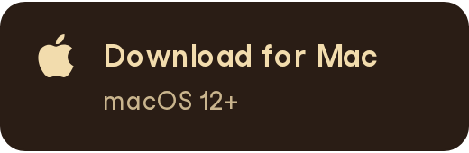
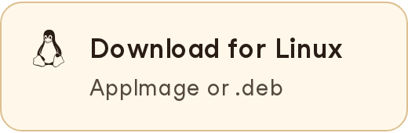
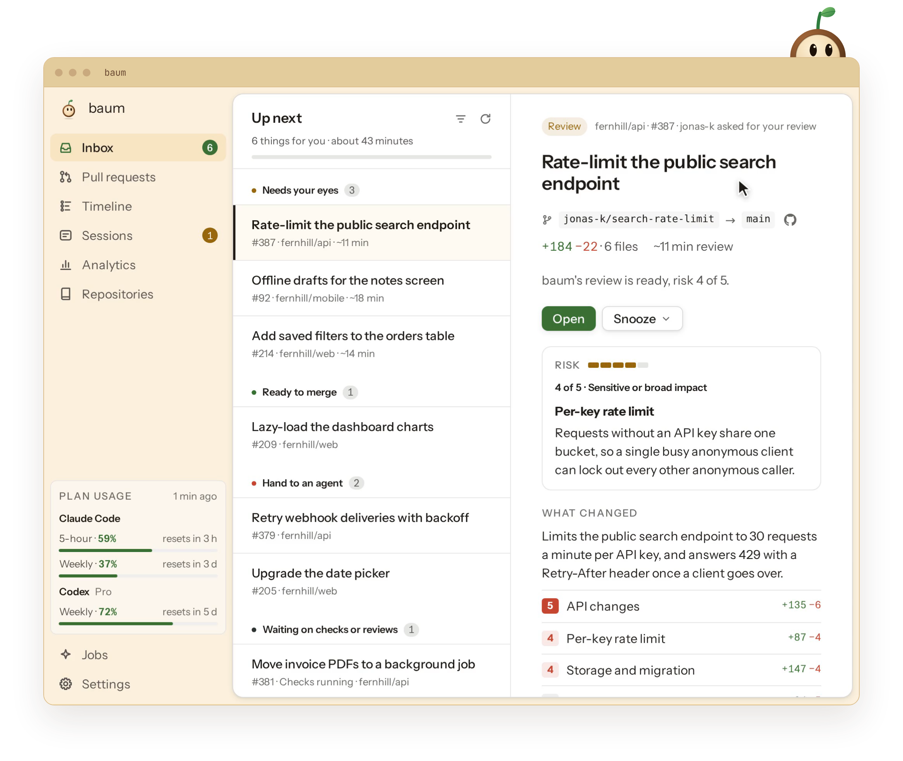

  <picture>
    <source media="(prefers-color-scheme: dark)" srcset="docs/readme/logo-dark.png">
    <source media="(prefers-color-scheme: light)" srcset="docs/readme/logo-light.png">
    
  </picture>

<strong>Review features. Not diffs.</strong> 
A desktop app for keeping up with what your coding agents build.

  <a href="https://usebaum.com">Website</a> ·
  <a href="https://docs.usebaum.com">Docs</a> ·
  <a href="https://discord.gg/NAguQUReAd">Discord</a>

  <a href="https://github.com/baum-ai/baum/releases/latest">
    <picture>
      <source media="(prefers-color-scheme: dark)" srcset="docs/readme/download-mac-dark.png">
      <source media="(prefers-color-scheme: light)" srcset="docs/readme/download-mac-light.png">
      
    </picture>
  </a>
  <a href="https://github.com/baum-ai/baum/releases/latest">
    <picture>
      <source media="(prefers-color-scheme: dark)" srcset="docs/readme/download-linux-dark.png">
      <source media="(prefers-color-scheme: light)" srcset="docs/readme/download-linux-light.png">
      
    </picture>
  </a>

  <a href="https://usebaum.com">
    <picture>
      <source media="(prefers-color-scheme: dark)" srcset="docs/readme/app-dark.png">
      <source media="(prefers-color-scheme: light)" srcset="docs/readme/app-light.png">
      
    </picture>
  </a>

## What is baum?

[baum](https://usebaum.com) is a desktop app that sits on top of your coding
agents. It reviews the pull requests in your GitHub repositories, shows which
Claude Code and Codex sessions need you, and links every change back to the
sessions and decisions behind it.

It runs on your computer. There is no baum account and no baum server: your
sessions, reviews and decisions stay on your machine, and reviews run through
your own Claude Code or Codex. See [privacy and data](https://docs.usebaum.com/privacy/).

## Features

- **Inbox**: the pull requests waiting on you, ranked by risk, with checks,
  approvals and conflicts in one place.
- **Reviews**: an explanation of each pull request, its parts ranked by how
  much they need you, instead of a line-by-line diff.
- **Sessions**: which agent sessions are waiting on you, and one click to their
  terminal or Claude app.
- **Timeline**: pull requests grouped into features, from work in progress to
  shipped, with the decisions made along the way.
- **Decision log**: the reasoning from the agent session behind any piece of
  code.
- **Usage**: how much of your Claude and Codex plans is left. A review is one
  short agent run, capped at 10 minutes.
- **GitHub-native**: baum writes to GitHub only when you press a button.

baum works with Claude Code (2.1.248 or newer) and Codex (0.156.1 or newer),
whatever the model.

## Install

Download the desktop app from the
[latest release](https://github.com/baum-ai/baum/releases/latest):

| System | File |
| --- | --- |
| macOS 12 or newer | `baum-desktop-darwin-universal.dmg` |
| Linux x86_64 | `baum-desktop-linux-amd64.AppImage` or `.deb` |

Open it and setup walks you through connecting GitHub, choosing your agent and
installing the `baum` command. See
[Install baum](https://docs.usebaum.com/getting-started/).

Until code signing is set up, macOS warns before opening the app; check the
download against `desktop-checksums.txt` from the same release. The release
also has the `baum` command line on its own.

## Docs

Everything else is at **[docs.usebaum.com](https://docs.usebaum.com)**. For
how the desktop app is built and released, see
[desktop/README.md](desktop/README.md); for the agent plugins, see
[plugins/README.md](plugins/README.md).

## License

[MIT](LICENSE). Third-party licences are in
[THIRD_PARTY_NOTICES.txt](THIRD_PARTY_NOTICES.txt) and
[desktop/THIRD_PARTY_NOTICES.txt](desktop/THIRD_PARTY_NOTICES.txt).
