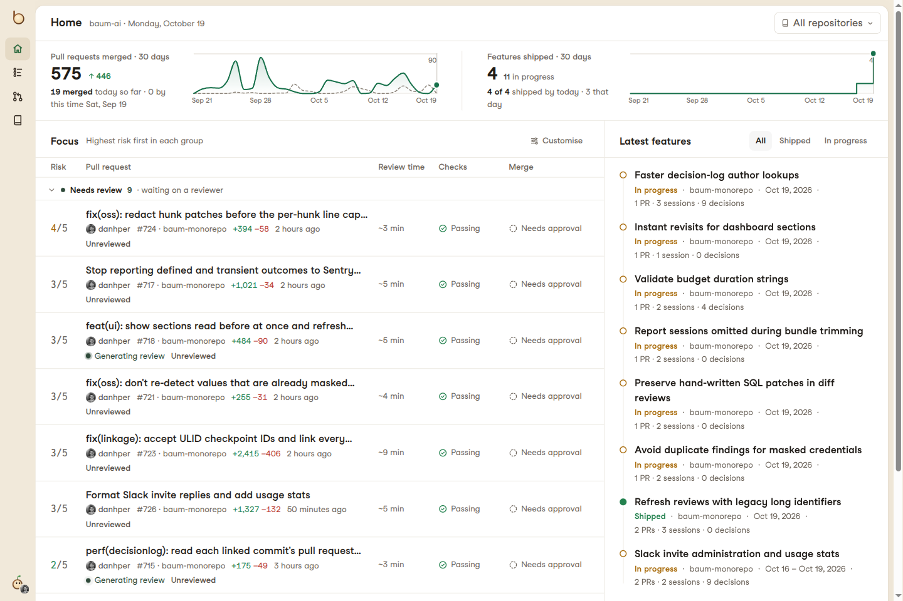
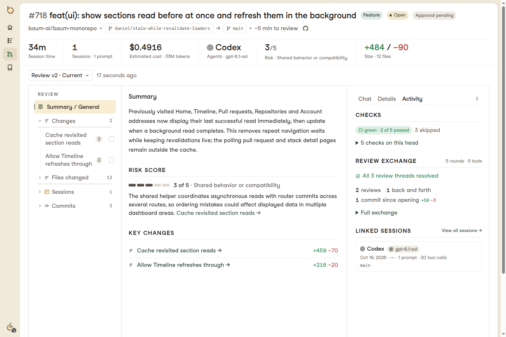
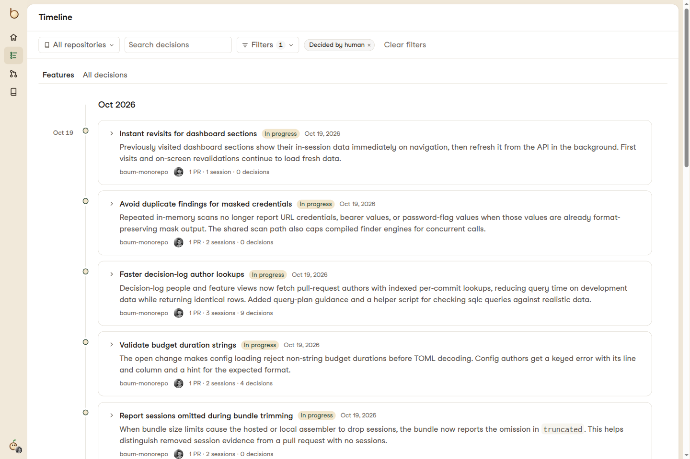

# baum

**Keep up with what your coding agents build.**

baum turns pull requests and agent sessions into clear reviews, a searchable
decision log and a timeline of features. See what changed, understand the
reasoning and focus on the calls that need your judgement.

**[Use baum at usebaum.com →](https://usebaum.com)**

## Know what needs you

Find the pull requests waiting on you, the changes that need attention and the
work that's ready to go. Risk scores, checks and approval status help you
choose where to start, while the latest features show what the team is building.



## Review the change with context

Get a clear explanation of what a pull request does, broken into sections
ranked by how much attention they need. Follow the risks to their supporting
evidence, inspect test results and see findings from your review agents in
one place. Discuss the change and record your verdict alongside the review.



## Find the “why” behind the code

Trace a change back to the agent sessions that produced it. Explore the
prompts, tool activity and decisions behind the implementation, with context
from Claude Code, Codex, Cursor and Entire sessions.

Search the decision log to find a past choice and the reasoning behind it,
without digging through transcripts or asking someone to remember.

## Follow features across pull requests

See related pull requests together as a feature, from work in progress to
shipped. Catch up on the outcome, the decisions along the way and the sessions
behind them. GitHub checks, comments and approvals stay connected.



## Try baum

Start at **[usebaum.com](https://usebaum.com)**. Access is currently limited;
you can join the waitlist there.

## Agent plugins

Install baum's versioned Claude Code or Codex lifecycle hooks from the public
Git marketplace. See [installation, trust and compatibility](plugins/README.md).
The plugins use your existing opt-ins and need the baum command on `PATH`.

## Install a release

Each tagged release on [GitHub Releases](https://github.com/baum-ai/baum/releases)
carries the desktop app and the `baum` command line. Replace `vX.Y.Z` with the
release's tag.

### Desktop app

Download the file for your system from the release:

| System | File |
| --- | --- |
| macOS 12 or newer (Apple silicon and Intel) | `baum-desktop-darwin-universal.dmg` |
| Linux x86_64 | `baum-desktop-linux-amd64.AppImage` or `baum-desktop-linux-amd64.deb` |
| Linux arm64, when the release has it | `baum-desktop-linux-arm64.AppImage` or `.deb` |
| Windows x64 | `baum-desktop-windows-amd64-setup.exe` |

`desktop-checksums.txt` lists the SHA-256 of each file, and every desktop file
has a build provenance attestation: `gh attestation verify FILE --repo baum-ai/baum`.

Builds are unsigned until code signing is set up for the project. A file that
is not signed has `-unsigned` in its name (`-unnotarized` if signed but not
notarised), and macOS Gatekeeper or Windows SmartScreen warns before opening
it. Only open a file you downloaded from the release page and checked against
`desktop-checksums.txt`. See [desktop/README.md](desktop/README.md) for what
the app does and how releases are built.

### Command line

The release also has `baum` archives: `baum-linux-amd64.tar.gz`,
`baum-linux-arm64.tar.gz`, `baum-darwin-amd64.tar.gz`,
`baum-darwin-arm64.tar.gz` and `baum-windows-amd64.zip`. Each holds the `baum`
binary, `LICENSE`, `THIRD_PARTY_NOTICES.txt` and this README. Check the
download against `checksums.txt` from the same release, then unpack it and put
`baum` on your `PATH`:

```sh
curl -LO https://github.com/baum-ai/baum/releases/download/vX.Y.Z/baum-linux-amd64.tar.gz
curl -LO https://github.com/baum-ai/baum/releases/download/vX.Y.Z/checksums.txt
sha256sum --check --ignore-missing checksums.txt   # macOS: shasum -a 256 --check --ignore-missing checksums.txt
tar -xzf baum-linux-amd64.tar.gz baum
./baum --version
```

With Go (the version in `go.mod`), build the same release from source:

```sh
go install github.com/baum-ai/baum/cmd/baum@vX.Y.Z
```

The desktop app bundles its own `baum`; [desktop/README.md](desktop/README.md)
describes how it installs the `baum` command and how that relates to one you
installed yourself.

## License

[MIT](LICENSE). The licences of the third-party software in the binaries and
the desktop app are in [THIRD_PARTY_NOTICES.txt](THIRD_PARTY_NOTICES.txt); the
desktop app's, which adds its Rust crates, is
[desktop/THIRD_PARTY_NOTICES.txt](desktop/THIRD_PARTY_NOTICES.txt).
